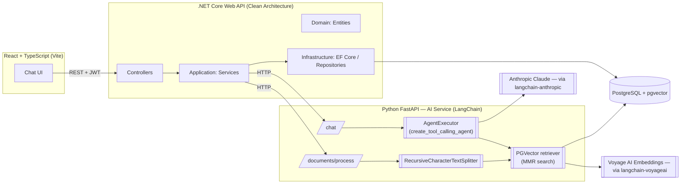

*English | [Türkçe](README.tr.md)*

# EE Assistant — LangChain-Powered RAG Technical Support Chatbot

An AI assistant built for technical teams working in environmental engineering / water treatment (RO and NF membrane systems). Users upload technical guideline documents, and the assistant answers questions grounded in that knowledge (RAG) — and can automatically open a support ticket when needed.

The AI service is built on **LangChain**: a `create_tool_calling_agent` drives the chat + tool-calling loop, `PGVector` (via `langchain-postgres`) backs the retriever, and `RecursiveCharacterTextSplitter` handles chunking — replacing an earlier hand-rolled RAG pipeline that called the Anthropic SDK directly.

This project was built from scratch, step by step, as part of a full-stack software internship.

## Key Features

- 🔐 **JWT-based authentication** — register/login, protected endpoints
- 💬 **Multi-conversation management** — multiple chats, persisted message history, multi-turn context
- 📄 **Document upload & processing** — text extraction, chunking, and embedding generation for PDF / DOCX / TXT / MD files, via LangChain document loaders and `RecursiveCharacterTextSplitter`
- 🔎 **RAG (Retrieval-Augmented Generation)** — the user's question is matched against document chunks through a LangChain `PGVector` retriever (MMR search) and passed to Claude as context
- 🎯 **Scope control** — the assistant only answers questions within its domain and politely declines out-of-scope ones (math, general knowledge, etc.)
- 🛠️ **Agentic tool calling for automatic support tickets** — a LangChain `AgentExecutor` lets Claude call a `create_support_ticket` tool when a user explicitly asks for a support/service request, and the backend automatically creates a ticket
- 🎨 **Modern chat UI** — ChatGPT/Claude-style interface with document-specific suggestion cards and a real-time "typing..." indicator

## Architecture



Responsibilities are cleanly split: **.NET** owns authentication, data persistence, business rules, and conversation/ticket state; **Python** handles AI/ML work only — the LangChain agent loop, retrieval, embeddings, and document chunking — and serves it to .NET over HTTP.

## Tech Stack

| Layer | Technologies |
|---|---|
| **Frontend** | React 19, TypeScript, Vite, React Router, Axios, react-markdown |
| **Backend** | .NET 10 (ASP.NET Core Web API), Clean Architecture (Domain / Application / Infrastructure / Api), Entity Framework Core, JWT Bearer Auth, BCrypt |
| **AI Service** | Python, FastAPI, **LangChain** (`langchain-core`, `langchain-classic` agents, `langchain-text-splitters`, `langchain-community` loaders), `langchain-anthropic` (Claude), `langchain-postgres` (PGVector), `langchain-voyageai` (embeddings), pypdf / python-docx (document extraction) |
| **Database** | PostgreSQL 16 + pgvector (vector similarity search) |
| **Infrastructure** | Docker Compose (PostgreSQL) |

## Project Structure

```
chatbot-app/
├── frontend/           # React + TypeScript SPA
│   └── src/
│       ├── api/            # HTTP calls to the backend
│       ├── components/     # Chat, document, layout components
│       └── store/          # Auth state
├── backend/
│   └── src/
│       ├── ChatBot.Domain/          # Entities (User, Conversation, Message, Document, SupportTicket...)
│       ├── ChatBot.Application/     # Services, DTOs, interfaces
│       ├── ChatBot.Infrastructure/  # EF Core, repository implementations, AI service client
│       └── ChatBot.Api/             # Controllers, DI configuration
├── ai-service/          # Python FastAPI + LangChain
│   ├── main.py              # FastAPI routes, LangChain agent + tool-calling setup
│   ├── vectorstore.py        # PGVector store/retriever (MMR search, per-user filtering)
│   ├── chunking.py           # RecursiveCharacterTextSplitter
│   ├── extraction.py         # Document loaders (PDF/DOCX/TXT/MD)
│   └── rate_limit_retry.py   # Voyage AI rate-limit retry handling
└── docker-compose.yml   # PostgreSQL + pgvector
```

## Getting Started

### Prerequisites
- .NET 10 SDK
- Node.js 20+
- Python 3.12+
- Docker (for PostgreSQL)

### 1. Database

```bash
docker compose up -d
```

### 2. Backend (.NET)

```bash
cd backend/src/ChatBot.Api
dotnet ef database update
dotnet run
```

Set your connection string and JWT secret in `appsettings.Development.json` (this file is gitignored and not part of the repo).

### 3. AI Service (Python)

```bash
cd ai-service
python -m venv venv
source venv/bin/activate  # Windows: venv\Scripts\activate
pip install -r requirements.txt
cp .env.example .env   # add your ANTHROPIC_API_KEY and VOYAGE_API_KEY
uvicorn main:app --reload --port 8000
```

### 4. Frontend

```bash
cd frontend
npm install
npm run dev
```

The app runs at `http://localhost:5173` by default.

## Roadmap

The project is being built step by step, with small, verified commits. Main milestones completed so far:

- [x] Authentication (JWT, register/login)
- [x] Conversation and message management
- [x] Claude API integration, multi-turn conversation history
- [x] Document upload, text extraction, and chunking
- [x] Voyage AI embeddings + pgvector integration
- [x] End-to-end RAG pipeline
- [x] Tool calling for automatic support ticket creation
- [x] RAG pipeline rewritten on LangChain (agent, PGVector retriever, text splitter, document loaders)
- [ ] Packaging the whole system with Docker Compose

## License

This project was built as part of a software internship.
