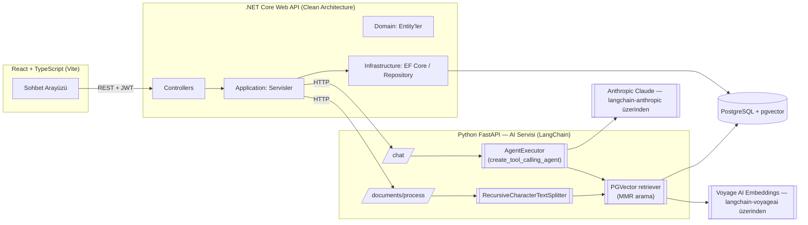

*[English](README.md) | Türkçe*

# EE Asistanı — LangChain Tabanlı RAG Teknik Destek Chatbotu

Çevre mühendisliği / su arıtma alanında (RO ve NF membran sistemleri) çalışan teknik ekiplere yardımcı olmak için geliştirilen, doküman tabanlı (RAG) bir yapay zeka asistanı. Kullanıcılar teknik kılavuz dokümanlarını yükler, asistan bu dokümanlardan öğrendiği bilgilerle sorulara cevap verir ve gerektiğinde otomatik olarak destek talebi (ticket) açabilir.

AI servisi **LangChain** üzerine kurulu: sohbet + tool calling akışını bir `create_tool_calling_agent` yürütüyor, retriever tarafını `langchain-postgres` ile `PGVector` karşılıyor, chunk'lama ise `RecursiveCharacterTextSplitter` ile yapılıyor — daha önce Anthropic SDK'sını doğrudan çağıran elle yazılmış RAG akışının yerini bu aldı.

Bu proje, full-stack bir yazılım stajı kapsamında sıfırdan, adım adım geliştirilmiştir.

## Öne Çıkan Özellikler

- 🔐 **JWT tabanlı kimlik doğrulama** — kayıt/giriş, korumalı endpoint'ler
- 💬 **Çoklu sohbet yönetimi** — birden fazla konuşma, geçmişe dönük mesaj listesi, çoklu-tur (multi-turn) bağlam
- 📄 **Doküman yükleme ve işleme** — LangChain doküman loader'ları ve `RecursiveCharacterTextSplitter` ile PDF / DOCX / TXT / MD dosyalarından metin çıkarma, chunk'lama ve embedding üretimi
- 🔎 **RAG (Retrieval-Augmented Generation)** — kullanıcı sorusu, LangChain `PGVector` retriever'ı (MMR arama) üzerinden en alakalı doküman parçalarıyla eşleştirilir, Claude'a bağlam olarak verilir
- 🎯 **Kapsam kontrolü** — asistan yalnızca kendi uzmanlık alanındaki sorulara cevap verir, alan dışı sorularda (matematik, genel kültür vb.) nazikçe reddeder
- 🛠️ **Agent tabanlı tool calling ile otomatik destek talebi** — bir LangChain `AgentExecutor`, kullanıcı açıkça bir arıza/destek talebi oluşturulmasını istediğinde Claude'un `create_support_ticket` tool'unu çağırmasını sağlar ve sistem otomatik olarak ticket kaydı oluşturur
- 🎨 **Modern sohbet arayüzü** — ChatGPT/Claude tarzında, doküman-özel öneri kartları, gerçek zamanlı "yazıyor..." göstergesi

## Mimari



Sorumluluk paylaşımı net bir sınırla ayrılmıştır: **.NET** kimlik doğrulama, veri kalıcılığı, iş kuralları ve sohbet/ticket durumunu yönetir; **Python** yalnızca AI/ML işlerini yapar — LangChain agent akışı, retrieval, embedding üretimi ve doküman parçalama — ve HTTP üzerinden .NET'e hizmet verir.

## Teknoloji Yığını

| Katman | Teknolojiler |
|---|---|
| **Frontend** | React 19, TypeScript, Vite, React Router, Axios, react-markdown |
| **Backend** | .NET 10 (ASP.NET Core Web API), Clean Architecture (Domain / Application / Infrastructure / Api), Entity Framework Core, JWT Bearer Auth, BCrypt |
| **AI Servisi** | Python, FastAPI, **LangChain** (`langchain-core`, `langchain-classic` agent'lar, `langchain-text-splitters`, `langchain-community` loader'lar), `langchain-anthropic` (Claude), `langchain-postgres` (PGVector), `langchain-voyageai` (embedding), pypdf / python-docx (doküman çıkarma) |
| **Veritabanı** | PostgreSQL 16 + pgvector (vektör benzerlik araması) |
| **Altyapı** | Docker Compose (PostgreSQL) |

## Proje Yapısı

```
chatbot-app/
├── frontend/           # React + TypeScript SPA
│   └── src/
│       ├── api/            # Backend'e HTTP istekleri
│       ├── components/     # Sohbet, doküman, layout bileşenleri
│       └── store/          # Auth state
├── backend/
│   └── src/
│       ├── ChatBot.Domain/          # Entity'ler (User, Conversation, Message, Document, SupportTicket...)
│       ├── ChatBot.Application/     # Servisler, DTO'lar, interface'ler
│       ├── ChatBot.Infrastructure/  # EF Core, repository implementasyonları, AI servis istemcisi
│       └── ChatBot.Api/             # Controller'lar, DI konfigürasyonu
├── ai-service/          # Python FastAPI + LangChain
│   ├── main.py              # FastAPI route'ları, LangChain agent + tool calling kurulumu
│   ├── vectorstore.py        # PGVector store/retriever (MMR arama, kullanıcı bazlı filtreleme)
│   ├── chunking.py           # RecursiveCharacterTextSplitter
│   ├── extraction.py         # Doküman loader'ları (PDF/DOCX/TXT/MD)
│   └── rate_limit_retry.py   # Voyage AI rate-limit retry mantığı
└── docker-compose.yml   # PostgreSQL + pgvector
```

## Kurulum ve Çalıştırma

### Gereksinimler
- .NET 10 SDK
- Node.js 20+
- Python 3.12+
- Docker (PostgreSQL için)

### 1. Veritabanı

```bash
docker compose up -d
```

### 2. Backend (.NET)

```bash
cd backend/src/ChatBot.Api
dotnet ef database update
dotnet run
```

`appsettings.Development.json` içinde bağlantı dizesi ve JWT secret'ını kendinize göre ayarlayın (bu dosya `.gitignore`'dadır, repoda yer almaz).

### 3. AI Servisi (Python)

```bash
cd ai-service
python -m venv venv
source venv/bin/activate  # Windows: venv\Scripts\activate
pip install -r requirements.txt
cp .env.example .env   # ANTHROPIC_API_KEY ve VOYAGE_API_KEY'i girin
uvicorn main:app --reload --port 8000
```

### 4. Frontend

```bash
cd frontend
npm install
npm run dev
```

Uygulama varsayılan olarak `http://localhost:5173` üzerinde açılır.

## Yol Haritası

Proje adım adım (küçük, doğrulanmış commit'lerle) geliştiriliyor. Tamamlanan ana aşamalar:

- [x] Kimlik doğrulama (JWT, kayıt/giriş)
- [x] Sohbet ve mesaj yönetimi
- [x] Claude API entegrasyonu, çoklu-tur konuşma geçmişi
- [x] Doküman yükleme, metin çıkarma ve chunk'lama
- [x] Voyage AI embedding + pgvector entegrasyonu
- [x] Uçtan uca RAG akışı
- [x] Tool calling ile otomatik destek talebi oluşturma
- [x] RAG akışının LangChain ile yeniden yazılması (agent, PGVector retriever, text splitter, doküman loader'ları)
- [ ] Docker Compose ile tüm sistemin tek komutla paketlenmesi

## Lisans

Bu proje bir staj çalışması kapsamında geliştirilmiştir.
